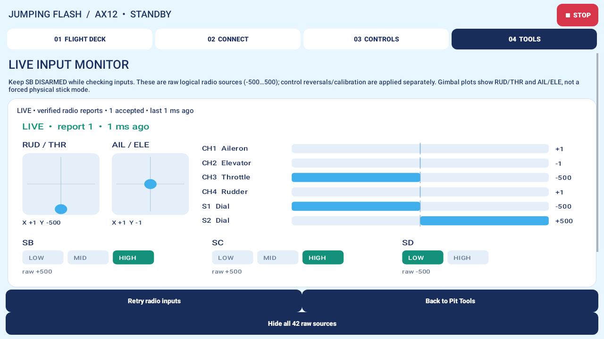

# AX12 v0.6.1 — independent serial setup and live input monitor

[Download APK v0.6.1](../releases/JumpingFlash-AX12-v0.6.1.apk). Install over the existing app. **No Stick reflash is needed.** Direction-test motor commands, mirrored signs, current/speed/run guards, CAN watchdog checks and SB rearming rules are unchanged.

## What failed

The user screenshot showed `/dev/ttyS0` open at **9600 baud**, canonical input/echo enabled (`lflag=0x8a3b`). The successful real capture used921600baud. The old live reader opened the port read-only without configuring it, inheriting the terminal settings left by the stock RadioMasterAX app. Opening the stock app once happened to repair the terminal settings. The text “Internal inputs running” described an open worker/port, not verified controls, and was misleading.

## Live initialization

The live path now acquires the existing exclusive ioctl, sets **921600baud, raw8N1, CLOCAL/CREAD, no hardware/software flow control**, reads the settings back and verifies them. A failed setup or mismatch closes the descriptor and blocks inputs. Buffered old input is flushed before any fresh control sample can be accepted.

The fd remains **O_RDONLY**: this changes local UART/TTY configuration, not radio settings, and adds no UART writes, modem-line commands, root/permission changes, RF control, motor output or automatic enable. It is not the old passive probe: the separately available passive capture still preserves terminal settings and only queries them. Stock RadioMasterAX must remain stopped while our app owns the input stream; TIOCEXCL blocks later ordinary opens but cannot evict a reader that already had the port open.

Only complete, CRC-valid source packets with the verified layout and valid required control values can produce LIVE. A port with no bytes or no valid packets says NOT LIVE. Reports older than120ms say STALE and continue to block commands. Opening/recovering a serial fd never rearms a motor. Per-session exports include actual terminal settings, byte counts, accepted/rejected latest-source updates, CRC/discard counters, first/last report timestamps, startup time, maximum update gap and gaps of at least120ms. These are software receive/update timings, not end-to-end control latency or an independent radio heartbeat.

This removes the **known local baud-setting dependency**. It is not evidence that every possible AT32 cold-start/stream-initialization state works; if a cold boot produces no packets despite correct verified terminal settings, that will be visible as NOT LIVE and needs separate investigation.

## Live input monitor

Open **TOOLS → Live input monitor • gimbals, dials & switches**.

- Two logical gimbal plots: RUD/THR and AIL/ELE. They do not impose a transmitter stick mode.
- Signed raw bars for CH1aileron, CH2elevator, CH3throttle, CH4rudder and S1/S2.
- SB/SC three-position indicators and SD two-position indicator.
- Accepted report number and age. Missing, invalid and stale data do not retain active-looking bars.
- Optional **Show all42raw sources**; only verified names are labeled, other entries retain source indices. `-32768` means unavailable.

This display shows native raw values before mapping/reversal/calibration. Physical SB high/low is not sufficient to infer the downstream arm selection when a reversal is configured. **Keep SB DISARMED while checking inputs**: normal live controls remain active elsewhere in the app; this monitor is not a robot-output lockout. It does not generate commands of its own. The monitor works without a Bluetooth/motor connection and redraws while visible at up to25Hz without adding CAN reads.

## Hardware acceptance before competition use

1. Keep the stock app Force stopped, SB DISARMED and motor supplies off for the input-only check. Reboot the AX12; open **only Jumping Flash**. Do not bootstrap through RadioMasterAX. Verify the monitor reaches LIVE and all four gimbal axes, both dials and relevant switches respond correctly.
2. Repeat cold boot and foreground/background transitions. The source may resume automatically, but robot arming must always require the existing deliberate SB-off/arm sequence after interruption. Record failure/recovery behavior rather than treating port-open/BLE-connected as success.
3. Run a sustained foreground input-monitor session, exercise every control periodically, then export the log. Review report startup time, valid-update gaps, CRC/discard counts and any STALE events. A good short run does not establish arena reliability.
4. On unloaded motor hardware, repeat both-motor direction selection, neutral, SB stop, app STOP, Bluetooth-loss stop, no automatic restart, and loss of either CAN motor. Use independent observation for physical stopping latency where timing matters; source/notification ages alone do not measure it.

Physical cold-start, long-run and interruption results are still required. Existing user feedback confirms both motor directions in the unloaded direction test; it does not establish loaded stopping, input latency, packet-loss margins or competition qualification.

## Validation

The native host test starts a real Linux pseudo-terminal at canonical9600baud with echo and software flow control, verifies live reinitialization/readback at raw921600/8N1, verifies old buffered input is discarded, checks exact binary delivery (including CR/LF, XON/XOFF and high bytes), checks read-only/exclusive behavior and repeats after another owner resets the port. The passive path is also tested to preserve settings. This is real host tty behavior, not AX12 hardware validation.

Android tests verify port-open is not LIVE, stale reports expire, source recovery and lifecycle behavior remain intact, the app uses the live port implementation, and the new monitor clears stale raw values without requesting arm. `scripts/check.sh` now runs the native tty test alongside the existing firmware/protocol simulations. The NDKr27c/API28 ARM64 library is rebuilt from checked-in source and its source/binary hashes remain build-verified.

Release checks: Android build/lint and62 unit/UI tests passed. Native tty and existing firmware/protocol checks passed. Monitor preview is a host render, not a physical AX12 acceptance result.
