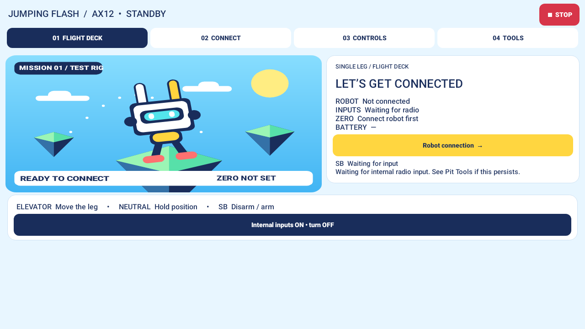
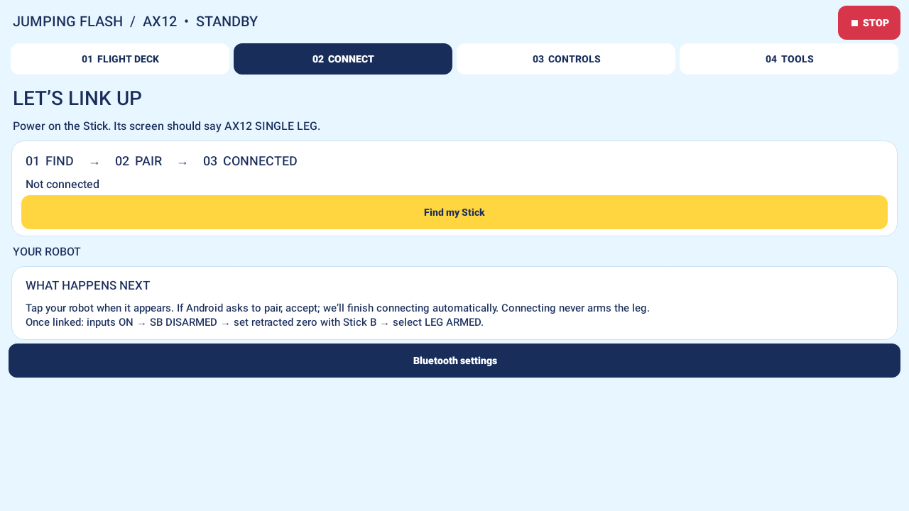

# AX12 v0.5.0 — flight deck and guided connection

[Download APK](../releases/JumpingFlash-AX12-v0.5.0.apk). Install over the previous development-signed app. **Stick v0.1 is unchanged; no reflash is needed.** Native input remains default-on, with its remembered OFF switch, automatic foreground resume and existing stale-input/arming rules.

## Interface

The original vector scenery uses a bright sky, floating islands, mechanical scout, yellow accents and navy HUD panels inspired by the playful feel of Jumping Flash. No game images, fonts or audio are bundled. The launcher icon follows the same visual design.

The flight deck concentrates on the one-leg rig: connection, input freshness, reference, measured travel, battery and actual motor arm state. STOP remains visible above every page. STOPPING is shown when a motor still reports enabled after local disarm; fault feedback stays prominent. Graphics are decorative, never proof of physical state or an actuator command.

Controls explains SB and elevator, with direction reversals available directly. Spinner, jump, height actuation and gait execution remain unavailable on the current firmware. Advanced calibration, input logs and the old passive serial probe are in Pit Tools rather than normal navigation.

## Connecting

1. Power the Stick; its screen must say AX12 SINGLE LEG.
2. Open **CONNECT → Find my Stick**. The app guides Bluetooth permission, Bluetooth enable and Android9's Location requirement when needed. The requested search resumes after those prompts.
3. Only peripherals advertising the Jumping Flash service appear. Tap **Connect this Stick** on the matching robot card. No separate chooser dialog is needed.
4. Accept Android pairing if requested. The original connection request continues automatically after bonding, including when Android's pairing UI temporarily backgrounds the app. There is no second Connect tap.
5. Wait for STICK CONNECTED and fresh robot telemetry. Connecting never arms or sets reference. Verify SB DISARMED and the retracted pose, then hold physical Stick B2s for reference before deliberately arming.

The selected address is remembered for **Reconnect last Stick** on subsequent visits. Real link loss still disarms and requires a user reconnect; this is not unattended reconnection or automatic arming. Explicit Disconnect cancels pending pairing continuation; late bonding and unrelated Bluetooth pairing broadcasts cannot restart it. Permission revocation and cancelled pairing show retry guidance.

One BLE connection is bidirectional: acknowledged control writes from AX12 to Stick, and status notifications from Stick to AX12. A second connection between the same radios is not an independent backup.

## Validation

Android APK build and lint pass. 56 Android9/API28 tests pass, including service-filtered scanning, pairing continuation, pairing across a foreground transition, cancellation/late-bond rejection, unrelated pairing, native input lifecycle, UI screen renders and actual STOPPING/fault feedback. Screenshots above are host renders, not evidence of a physical Bluetooth connection. Physical pairing, telemetry and motion acceptance remain to be run on the user's rig. The protocol, motor limits, CAN watchdog and firmware binary are unchanged.
